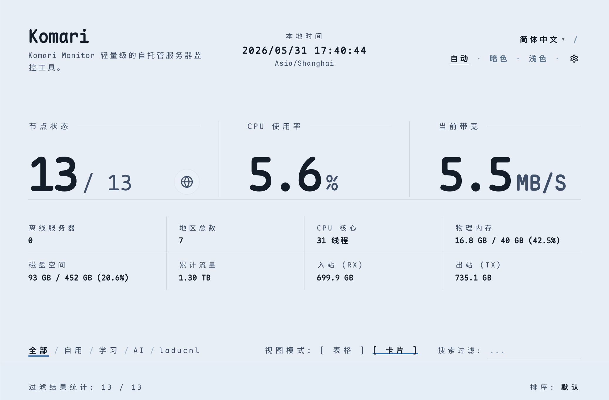

# Komari Zen Verge

基于极简主义设计理念的 [Komari Monitor](https://github.com/komari-monitor/komari) 主题，Fork 自 [qwer-xyz/komari-theme-zen](https://github.com/qwer-xyz/komari-theme-zen)。

在保留 Zen 的克制、留白与秩序感的前提下，添加来自deer主题的很fancy的世界地图并完善更fancy的地图交互功能

由DeepSeek 4.1f开发完成，整个项目基本只有这一点README是我自己写的233333



## 安装

1. 在 [Releases](https://github.com/Bryant-Xue/komari-zen-verge/releases) 下载最新的 `zen-theme-v*.zip`
2. 进入 Komari 后台 → 主题管理 → 上传该 zip 并启用
3. 进入 Komari 后台 → Zen 主题管理 → 按需调整设置

主题会在后台注册独立的「Zen 主题管理」设置页，所有个性化项都在那里改，无需手改配置文件。

## 功能

### 首页总览

- 表格 / 卡片双视图，可指定默认视图、默认排序指标与排序方向
- 节点分组、搜索过滤，离线节点可选排在首位 / 保持原位 / 排在末尾
- CPU、内存、硬盘、带宽、流量、延迟等指标，首页 CPU 与带宽可切换「平均值 / 最大值」口径
- 离线节点保留占位与状态提示，不会让整页塌掉

### 世界地图

- 首页节点分布地图，样式可选 `Zen` 或迁移自 [komari-deer](https://github.com/DeerYang/komari-deer) 的 `Deer`
- 详情页地区状态世界地图：按国家 / 地区聚合「全部在线 / 部分在线 / 全部离线」
- 支持点击国家下钻、悬浮统计、未映射地区清单

### 延迟检测

- 卡片与详情页的延迟色块，分级模式可选「固定阈值」或「均值偏移」，阈值均可调
- 延迟探针面板：多检测点曲线、平滑 / 断点连线、波动视图、时间范围缩放与拖动读数
- 采集断档会在曲线上显式标注，避免把无数据误读成 0ms

### 节点详情

- 硬件规格、实时负载、磁盘空间、网络传输分段报表
- 进程数、TCP/UDP 连接数、系统平均负载、内核 / 虚拟化 / GPU、Agent 版本与运行时间
- 历史曲线支持游标拖动读数与时间范围切换

### 账单与剩余价值

- 到期时间、自动续费状态、计费周期与续费价格
- 剩余价值统计：按到期时间折算并换算为主货币，支持多币种汇总，未计入的节点会说明原因（免费 / 未设价格 / 未设到期 / 长期 / 无法识别币种 / 无可用汇率）

### 外观

- 亮色 / 暗色 / 跟随系统三态切换
- 配色预设：暖色、红色、黄色、绿色、蓝色、紫色、黑白；页面背景、卡片 / 弹层、强调色均可自定义
- 字体预设：默认、等宽、游梦、霞鹜文楷、文源圆体，或填自定义字体族与字体 CSS 地址
- Logo 显示与形状（圆形 / 圆角 / 方形）、自定义页脚 HTML
- 界面语言：简体中文 / 繁體中文 / English / 日本語 / Bahasa Indonesia

## 开发

```bash
npm install
cp .env.example .env.development   # 填入 VITE_API_TARGET=https://你的 Komari 地址
npm run dev                        # 本地 3000 端口，/api 与 /themes 走代理
```

常用命令：

| 命令 | 作用 |
| --- | --- |
| `npm run dev` | 启动开发服务器（`--host 0.0.0.0`，方便手机上看） |
| `npm run lint` | `tsc --noEmit` 类型检查 |
| `npm run build` | 生成世界地图数据后打包到 `dist/` |
| `npm run generate:map` | 只重新生成世界地图数据 |
| `npm run pack` | 打出 `releases/zen-theme-v<version>.zip`（依赖 `zip` 命令，Windows 下请用 WSL / Git Bash） |
| `npm run preview` | 预览生产构建 |

## 发布

版本号有两处，必须同步：`package.json` 与 `komari-theme.json` 的 `version`。

```bash
git tag v1.3.1
git push origin v1.3.1
```

推送 `v*` 标签会触发 [Release 工作流](./.github/workflows/release.yml)：`npm ci` → 类型检查 → 构建并打包 → 创建 GitHub Release 并附上 `zen-theme-v*.zip`，无需手动上传。

## 技术栈

React 19 · TypeScript · Vite 6 · Tailwind CSS v4

## 鸣谢

- [qwer-xyz/komari-theme-zen](https://github.com/qwer-xyz/komari-theme-zen) —— 本项目的上游主题
- [DeerYang/komari-deer](https://github.com/DeerYang/komari-deer) —— `Deer` 地图样式的来源
- [Komari](https://github.com/komari-monitor/komari)
- [Komari Web](https://github.com/komari-monitor/komari-web)
- [React](https://react.dev/)
- [Vite](https://vite.dev/)
- [Tailwind CSS](https://tailwindcss.com/)
- 汇率数据由 [ExchangeRate-API](https://www.exchangerate-api.com/) 提供

## 许可证

[MIT](./LICENSE)
